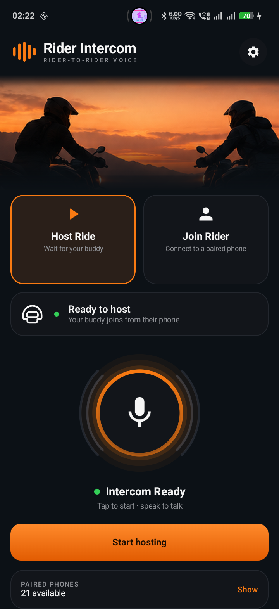
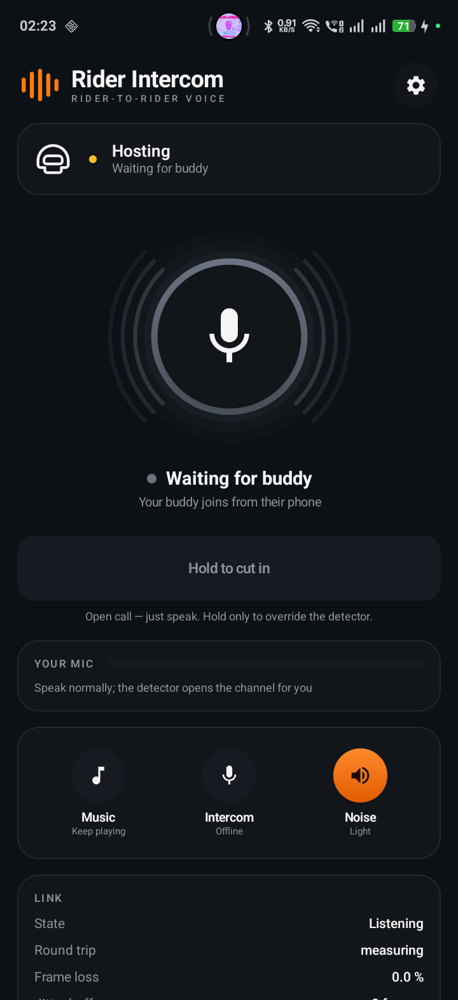
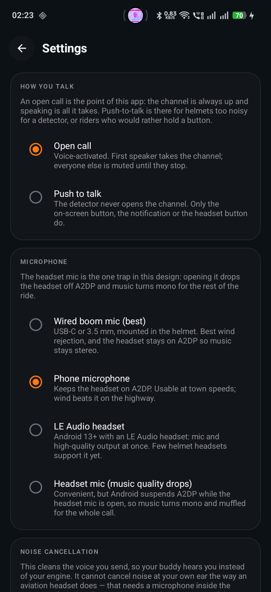

# Rider Intercom

**Talk to your riding buddy without a dedicated intercom — no cell signal needed.**

Most riders don't own a dedicated helmet intercom. And even a phone call won't help when you're riding through mountains, forests, or rural stretches with no reception. Wind noise and engine roar make shouting impossible. This app turns two Android phones into a direct rider-to-rider voice link over Bluetooth — no internet, no cell tower, no cloud service, no subscription. Just pair, tap, and talk.

> **[Download APK](rider-intercom.apk)** — Android 10+ required. Install on both phones.

---

<p align="center">
  
  &emsp;
  
  &emsp;
  
</p>
<p align="center">
  <em>Home screen</em> &emsp;&emsp;&emsp;&emsp;&emsp;&emsp;&emsp;
  <em>Active call</em> &emsp;&emsp;&emsp;&emsp;&emsp;&emsp;&emsp;&emsp;
  <em>Settings</em>
</p>

---

## How to use

1. **Install** the app on both phones.
2. **Pair** the phones via Bluetooth (standard pairing in phone settings).
3. **Grant permissions** when prompted — microphone, Bluetooth, and notifications.
4. **Rider A** taps **Host Ride** → **Start hosting**. The phone listens for a buddy.
5. **Rider B** taps **Join Rider** → selects the host from paired devices.
6. **Talk.** The channel is always open — just speak and your buddy hears you.

### Talk modes

| Mode | How it works |
|------|-------------|
| **Open call** (default) | Voice-activated. Just speak — the detector opens the channel. First speaker holds the floor; the other side is muted until they stop. |
| **Push to talk** | Hold the on-screen button, the notification button, or a Bluetooth headset button to talk. For helmets too noisy for the voice detector. |

### Microphone options

Pick what suits your helmet in **Settings → Microphone**:

- **Phone mic** — simplest. Works at town speeds; wind beats it on the highway.
- **Wired boom mic** (USB-C / 3.5 mm) — best wind rejection. Headset stays on A2DP so music stays stereo.
- **LE Audio headset** — mic + hi-fi output at the same time. Android 13+; few helmet headsets support this yet.
- **Headset mic** — convenient, but Android drops music to mono while the mic is open.

## What works

- Direct voice calls over Bluetooth RFCOMM — no internet, no server
- Automatic fallback to Wi-Fi Direct for longer range
- Voice activity detection — the channel opens when you speak
- Half-duplex floor arbitration — one speaker at a time, no crosstalk
- IMA ADPCM codec at 16 kHz / 20 ms frames (low latency, low bandwidth)
- Spectral noise suppression — cleans wind and engine noise from your voice
- Foreground service — call stays alive with the screen off
- Headset button control (play/pause to cut in)
- RTT measurement and clock sync between phones
- BLE nearby-host discovery — find hosting phones without manual pairing
- HFP Audio Gateway — bridges with helmet Bluetooth intercoms
- Automatic transport switching when signal degrades (no manual intervention)

## Known issues

- **Noise suppression level stuck**: The denoiser works and does reduce wind/engine noise, but the Settings selector (Light / Medium / Strong) may not apply correctly on some devices — it stays on one preset regardless. This is a UI binding issue, not a DSP bug.

- **Wi-Fi Direct joiner path**: The Wi-Fi Direct transport (longer range) works for hosting but the client/joiner side has not been road-tested on all devices.

## How it works

```
Phone A                                    Phone B
┌─────────────┐     Bluetooth / Wi-Fi Direct     ┌─────────────┐
│  Mic → ADPCM ├────────────────────────────────►│ ADPCM → Spk │
│  Spk ← ADPCM │◄────────────────────────────────┤ Mic → ADPCM │
└─────────────┘                                  └─────────────┘
         No internet. No cell signal. Direct radio link.
```

The two phones connect directly over Bluetooth Classic (RFCOMM) or Wi-Fi Direct — both are device-to-device radios that work without any network infrastructure. Voice is compressed with IMA ADPCM (4-bit per sample, 32.6 kbps) and sent in 20 ms frames. A spectral denoiser strips wind and engine noise before transmission. The app monitors link quality and switches between Bluetooth and Wi-Fi Direct automatically if the signal degrades.

## Related

This intercom module has been integrated into the [KTM Nav Gen3](https://github.com/Pavanayi1/KTM-Nav-GEN3) app for a combined motorcycle dashboard navigation + rider intercom experience. See that repo for the full bike control setup.

## Building from source

```bash
git clone https://github.com/Pavanayi1/intercom.git
cd intercom

./gradlew :app:assembleDebug

adb install -r app/build/outputs/apk/debug/app-debug.apk
```

**Requirements**: Android Studio, JDK 17, Android SDK 35, min SDK 29 (Android 10).

## Project structure

```
app/src/main/java/com/intercom/app/
├── audio/          # ADPCM codec, mic capture, jitter buffer, denoiser, player
├── call/           # CallController, IntercomService (foreground service)
├── discovery/      # Host beacon & scanner (BLE nearby discovery)
├── floor/          # Voice activity detector, half-duplex floor arbiter
├── hfp/            # HFP Audio Gateway (helmet intercom bridge)
├── media/          # Media button handling, audio focus
├── protocol/       # Wire protocol codec & message types
├── transport/      # RFCOMM, Wi-Fi Direct, LinkSelector, SwitchPolicy
├── ui/             # Compose UI screens
└── util/           # Permissions, preferences, OEM quirks
```

## License

Private — not for redistribution.
